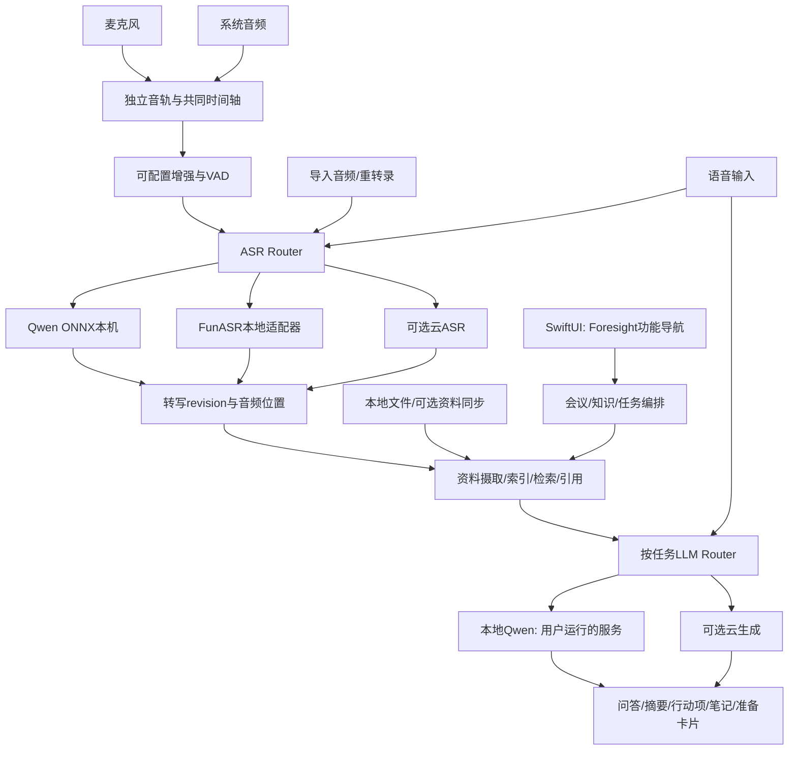

# 本地会议与知识助手 Product Spec v0.3

2026-10-15 · 用户目标刷新 · Foresight完整界面与功能 × 内置本地模型 × DeepSeek默认生成。实现状态以implementation-status.json为准。

本版依据用户2026-10-15指示替代v0.2。完整产品范围不缩减；不再把“手动填写模型目录/运行库/Python路径的短WAV工作台”当成最终产品。

**当前明确交付目标**：开发并交付hansluo/meeting-mac。整体界面与功能参考Foresight，完整中文体验。由开发方下载、校验并接好默认本地embedding和ASR，用户无需手动部署模型服务。对话、资料整理、引用问答、会议纪要模板、行动项和笔记增强默认使用可配置DeepSeek云端API；普通用户只需填写自己的云端Key，地址和模型预填。保留替换引擎及高级接入，不要求额外本地大语言模型才能完成主流程。

默认三种角色：Google EmbeddingGemma300M文本向量化；MAC-record默认SenseVoice INT8本机转写；DeepSeek云端文本生成。FunASR为已实现的可选ASR，Gemma4/本地Qwen生成作为后续可选方案，不是默认安装前置条件。

“micro recorder”按既有上下文解释为用户的MAC-record；“100年以后”按日后整理资料理解。若用户后续另有所指再修订，不因此阻止已明确工作。

## 1. 产品目标与变更决定

目标是一个macOS上的会议与个人知识助手。用户可以导入自己的资料，录制或导入会议音频，得到可核对的转写、会议纪要、行动项、增强笔记，并在会前和会中获得有来源的答案。语音输入是共享底层能力的独立入口，不取代会议主线。

用户反馈Foresight内置ASR效果不佳、模型接入受限。这是此次改版的明确动机；尚未用同一音频建立质量对照，不能预先保证更换模型一定改善所有场景。

| 范围 | 决定 |
|---|---|
| 产品中心 | 保留知识库、资料问答、会议、笔记、行动项、备会、历史搜索、主动卡片及可选知识组织 |
| 桌面基础 | 建议SwiftUI与原生macOS音频层，复用MAC-record可适配模块；不要求重建Flutter壳 |
| ASR | Qwen3-ASR ONNX/sherpa-onnx本机路径 + 新增FunASR适配器；可按实时/文件/重转录分别选择 |
| 生成模型 | 默认DeepSeek云端，用于对话、资料整理与会议模板处理；本地Qwen/Gemma与兼容服务为可选高级项 |
| 云端 | DeepSeek为默认文本生成方案；填写Key并启用对应任务后发送必要文本。原始音频不因云端生成而上传，云ASR仍单独选配 |
| embedding与检测 | 默认内置Google EmbeddingGemma300M；检测先用本地规则/可验证轻量方案。embedding、ASR、生成能力分别验证 |
| 复用方法 | 功能语义和成熟模块复用；原厂服务、模型格式、私有标识和未恢复ABI均不作为实现依赖 |

首版仍以Apple Silicon为目标。MAC-record源码配置为macOS 14.0+；融合应用最低版本需在同时采集和依赖验证后冻结。中文、英文、粤语与混合专名进入评测集，未通过的语言不能仅凭模型说明标为产品支持。

## 2. 事实、方案与来源

Foresight的静态配置、提示词、协议和机制证据沿用本包01至05目录。其函数实现、网络行为与性能仍未完全恢复。

MAC-record此次读取固定commit `ad53c5740e59498d6c9869c04027c2daddd1b48d` 的30份选择性文件，Git blob SHA逐一核对通过；没有构建或运行。源码来源与复用审计见07目录。

| 来源ID | 依据 | 证据性质 |
|---|---|---|
| E-FS | Foresight提示词、RAG descriptor、模型配置和机制字符串 | 静态观察；功能调用与性能不等于已验证 |
| E-MAC-ASR | ModelRegistry、SherpaOnnxWrapper、NativeASRService、ASRBackendTypes | 有Qwen/SenseVoice注册与离线解码代码；实际运行待测 |
| E-MAC-AUDIO | AudioRecorder、SystemAudioRecorder、AppState+Recording、AudioEnhancer | 原生音频与处理源码；当前音源选择不是双轨并行 |
| E-MAC-LLM | LLMService、LLMConfigStore、SummaryGenerator | 本地探测、兼容协议、配置与长文整理实现 |
| E-MAC-INPUT | VoiceInputService、VoiceInputCorrectionService、TextInjector | 全局语音输入与文字注入源码 |
| E-MAC-DATA | Recording、RecordingPersistenceCoordinator、AppState、ExportManager | 录音保存、重转录、历史与导出源码 |
| E-UPSTREAM | 千问、FunASR、sherpa-onnx、Ollama、LM Studio官方资料 | 接口/能力说明；不替代本机与所选权重测试 |

下文“必须”是新产品要求，状态机与数据实体是自主设计。历史文档 `docs/feature-audit.md` 描述的是早期Python/FunASR工作台，不能作为当前Swift版本已有FunASR适配器的证明。

## 3. 功能融合边界

| 能力 | Foresight提供的产品方向 | MAC-record可参考的代码 | 融合决定 |
|---|---|---|---|
| 录音与转写 | 会议持续上下文 | 麦克风、ScreenCaptureKit、VAD、增强、ASR、睡眠处理 | 复用组件，新增同时采集、统一时钟和来源隔离 |
| 资料问答 | 文档索引、向量/图谱、引用问答 | 生成模型接入 | 以Foresight为主，新建来源与检索层 |
| 会后产出 | 分段/增量摘要、行动项、笔记增强 | 长文分段与递归归并、自定义Prompt | 保留任务分类，升级为token/版本/证据约束 |
| 会前与历史 | 日程、附件、历史会议关联 | 录音历史基础 | 新建日程与资料关联；不把录音列表当会议关系库 |
| 主动助手 | 检测问题、分发、sidecar | 音频和生成能力 | 保留产品方向，新增可替换检测与受控触发 |
| 音频文件与重转录 | 可作为知识来源 | 导入、逐段转写、重新识别 | 纳入核心会议闭环，保存转写revision与派生影响 |
| 语音输入 | 不属于已确认的核心入口 | 热键、浮窗、纠错、文字注入 | 独立入口，共享ASR/LLM但隔离会话和优先级 |
| 说话人 | 保留归因要求 | 离线分离wrapper与统一结果类型 | 能力可选；匿名标签不自动等于实名 |
| 导出与管理 | 回查、来源和删除 | 文本/音频/纪要/ZIP导出 | 新增来源引用、模型配置与版本清单 |

不纳入本版的能力是代发邮件、自动提交聊天、远端文件写入、团队共享和跨设备同步。语音输入只向用户选择的焦点写文字，不自动发送或提交。

## 4. 模型体系：模型、运行时、服务各自独立

Qwen是模型家族，FunASR是语音工具与管线体系，sherpa-onnx是可运行转换权重的推理运行时。三个名字不是可互换的配置值。每项能力必须绑定具体checkpoint/revision、模型格式、runtime版本和实际测试结果。

### 4.1 ASR路线

| 路线 | 初始候选 | 实时语义 | 定位与门槛 |
|---|---|---|---|
| 默认SenseVoice本机ONNX | SenseVoice INT8；MAC-record源码默认 | 分段offline decode，完整实时能力另测 | 内置默认、无Python要求；新增原生adapter并做同音频对照 |
| Qwen本机ONNX | Qwen3-ASR 0.6B/1.7B INT8；沿MAC-record wrapper | 当前代码为VAD分段后offline decode，标为segment-realtime | 优先复用，分别测延迟、质量与资源；不能承诺词级流式 |
| FunASR本地服务 | SenseVoice、Paraformer离线、Paraformer-zh-streaming等具体管线 | 只有流式checkpoint与会话缓存验证后才标native-streaming | 新增adapter；CPU/Mac与可选服务端分别验证，不要求CUDA |
| Qwen/FunASR文件精转 | 已验证的本地文件解码/可选对齐与分离管线 | batch/file，不与实时能力混称 | 导入音频、会后精转、替换旧ASR版本 |
| 云端ASR | 用户选择的千问实时/文件服务或明确支持的接口 | 依具体服务及adapter | 单独开关、鉴权、上传范围和格式；可选扩展 |

Qwen官方工具的流式示例当前限定vLLM后端；这不证明MAC-record的ONNX调用同样具有该协议。sherpa-onnx官方明确提供Qwen ONNX和macOS ARM64支持，可作为本机路线依据，实际性能仍须测试。[Qwen3-ASR](https://github.com/QwenLM/Qwen3-ASR)、[sherpa-onnx Qwen文档](https://k2-fsa.github.io/sherpa/onnx/qwen3-asr/index.html)。

FunASR官方区分离线、流式、VAD、标点和说话人管线；实时必须选择对应流式checkpoint并管理独立session cache。工具包的能力不能自动迁移到任意模型。[FunASR官方资料](https://github.com/modelscope/FunASR)。

**初始产品选择**：本次按MAC-record `ASRConfigStore.swift:10`的真实默认值采用SenseVoice INT8，使用匹配的sherpa原生管线。原仓库所带权重精确revision尚未确认，本应用固定官方可校验的同模型族资源，不冒称字节完全相同。Qwen0.6B/1.7B继续作为可切换路线；FunASR本地adapter必须进入基础里程碑，并在同一评测后允许用户设为首选。默认排序是开发选择，不是质量结论。SenseVoice可以保留为轻量备选，但不能替代用户要求的Qwen和FunASR选项。

### 4.2 默认DeepSeek生成与可选本地模型

默认provider为DeepSeek，base URL预填`https://api.deepseek.com`（兼容前缀按实际接口归一化），model按2026-10-15官方文档预填`deepseek-flash`，允许手动修改及显式模型发现。不能照搬过时别名或自动换成列表首项；失效需提示并让用户选定。API Key由用户填写，存Keychain，配置/日志/导出无Key。没有Key时录音、ASR、本地索引照常可用，生成任务明确显示待配置。

任务包括对话、资料引用问答、会议纪要、模板生成、行动项、笔记增强与备会。发送相应文本snapshot和必要检索片段，不自动上传整场原始音频或整个知识库。Prompt模板可选择、编辑、版本化；纪要绑定转写revision及证据。

本地生成（Qwen/Gemma）及Ollama、LM Studio、oMLX、自定义兼容服务继续支持，放在高级设置，不作为首次使用门槛。本版不要求额外下载本地对话模型；旧0.6B开发smoke模型不等于用户提到的2B默认模型。

这里“Gemini”与“Gemma”不是同一名称。原Foresight静态配置记录Gemma4 E2B/E4B/12B，并非可随意下载“Gemini4”的证明。Gemma4部分模型支持ASR，但不等于embedding模型能转录。

来源：[DeepSeek官方首次调用](https://api-docs.deepseek.com/)、[Google Gemma音频](https://ai.google.dev/gemma/docs/capabilities/audio)。接口能力以实际账号/模型测试为准，尚未使用用户Key验证云调用。

### 4.3 embedding、重排和问题检测

embedding为独立角色，模型版本、向量维度、归一化和索引generation绑定；切换后重建，不与生成模型混用。默认选择Google EmbeddingGemma300M文本模型，由应用管理下载与运行；Qwen3-Embedding仅作可选替换。[官方模型资料](https://github.com/QwenLM/Qwen3-Embedding)。

问题检测通过独立DetectorAdapter，优先简单规则/轻量本地模型的可测基线，可选择本地Qwen完成结构化判断。检测器与聊天大模型独立路由。图谱抽取和重排后置，必须证明增益，不能为了复现字符串而强制引入全套算法。

### 4.4 内置模型与普通用户体验〔v0.3必须〕

应用负责下载/校验/安装/加载默认模型与匹配runtime，在本机应用专属目录管理版本与清单。开发交付前预下载并验证所需资源；重新安装/新设备可通过内置下载流程恢复，不让用户粘贴路径、安装Homebrew或选择Python。模型不放Git源码，但交付必须包含可实际使用的模型准备方案，不以下载链接/安装说明代替完成。普通界面显示准备进度、磁盘/网络错误、重试和就绪状态；路径/线程/worker等放高级设置。

EmbeddingGemma输入文本、输出向量，不输出转写文字。即使新一代embedding支持音频输入，音频向量也不等于ASR。Foresight静态证据出现EmbeddingGemma及V2类型标记，尚不能确认原程序所用checkpoint与本方案300M完全相同；本方案是明确选择，不冒称已提取原权重。来源：[Google模型卡](https://ai.google.dev/gemma/docs/embeddinggemma/model_card)。

默认ASR选SenseVoice INT8，原生集成和实测仍待完成；Qwen3-ASR0.6B与FunASR此前已在本机真实短语音跑通，保留为高级选项。Google embedding仍需实际中文检索测试、hash与runtime验证。支持音频的Gemma4替代ASR必须另行对照评测，不因网上能力说明自动替换已跑通路径。

## 5. 本地、局域网与云端路由

分别配置实时ASR、文件ASR、问答、摘要、笔记增强、语音输入纠错、embedding和检测。ASR与embedding默认本地；生成默认DeepSeek云端并等待用户Key与任务启用。按任务切换不使整场录音或整个资料库自动转为云端。

### 路由状态

`unconfigured → discovered → authenticated → capability_tested → ready`。发现模型列表不等于生成测试通过；生成测试不等于支持embedding、vision、audio、tools、streaming或取消。

provider位置为on_device、lan、cloud或unverified。localhost不能单独证明推理在本机，服务可能代理云模型；严格离线配置必须确认实际模型执行位置并通过离线/网络场景验证。Ollama官方也允许经本地服务使用云模型。[Ollama本地与云模型说明](https://docs.ollama.com/api/openai-compatibility)。

### 回退规则

1. 缺模型、授权失败或能力不匹配，先明确错误，不自动更换model_id或上传数据。
2. 可以配置同位置的备选模型；记录替换原因与最终provider。
3. 跨到云端只在对应任务已允许、上传范围明确时发生；否则显示“改用已配置云模型”操作。
4. 云生成只发送该任务需要的文本和召回片段；云ASR会发送音频，是不同授权范围。
5. 没有本地ASR时用户仍可导入已有文本；没有生成模型时仍能录音和保存转写。功能就绪状态互相独立。

请求保存原始route、实际route、model版本和input snapshot，禁止日志保存Key。凭据进入Keychain，设置只保存引用。API endpoint/path归一化后显示最终地址，不能重复拼接 `/v1` 或丢失自定义前缀。

凭据写入使用可报告错误的更新/新增流程；成功后再提交配置，失败保留旧凭据和旧配置。测试使用临时凭据或已保存引用，不把Key写入配置JSON。删除连接按明确范围删除对应Keychain项。当前MAC-record的失效模型默认选第一项、Key先删后加以及测试/正式请求参数差异都需要修正，不能直接复用为最终路由实现。

## 6. 交互与设置

导航以Foresight结构为主：主页/日程、会议、知识库、聊天、笔记、可选知识组织、设置。会议详情吸收MAC-record的音频回放、转写/纪要视图、重新转录与导出。菜单栏提供录音状态和独立语音输入开关。

普通设置以“本地模型准备状态”和“DeepSeek API Key”呈现，云端地址/model预填可改。高级模型设置拆成三组：**转写引擎**、**生成模型**、**检索模型**。用户可以明确看见“Qwen ASR本机”“FunASR本地服务”“本地千问生成”“云端千问生成”等实际组合。高级设置才展开VAD、窗口、重试和token预算。

连接流程为选择provider → 输入地址/凭据 → 发现或输入模型 → 测试任务能力 → 选择任务用途 → 保存。支持手动model_id，不能因某服务没有models列表就否定其可连接性。

录音界面显示麦克风、系统音轨各自是否收到音频。模式包括仅麦克风、仅系统、双来源；当前MAC-record的二选一路径不能直接充当双来源实现。

重转录展示引擎、进度、可取消、旧/新版本差异与“采用新版本”操作。模型切换不覆盖正在录音session的引擎，正常在新任务或受控暂停边界生效。

语音输入浮窗与会议转写分开；两个入口同时工作时，前台短任务有优先级，但不能抢占到使会议丢音频。权限按使用功能请求，不因普通资料问答要求辅助功能权限。

## 7. 功能需求与验收

FR-001至FR-012保持v0.1身份，内容以本版为准；FR-013至FR-018是融合新增。每项AC为应完成的测试，不是已经验证的行为。

### FR-001 模型清单、下载与资源管理〔M0〕

必须自动准备默认本地ASR与embedding的模型和runtime，普通用户无需手填路径或安装Python。分角色管理格式、revision、hash、能力和就绪状态。下载、校验、加载和探活分开；允许受支持ASR的本地模型路径。文件缺失、错误权重、tokenizer不匹配或内存不足不得标ready。外部LLM服务由连接配置管理，不假装由App下载其模型。

验收 AC-001：全新用户正常入口无需手填本地路径，默认模型实际下载、校验、加载成功并完成中文转写与检索；损坏/缺文件/不匹配拒绝加载；切换embedding触发索引隔离；ASR忙时不会重复创建无限实例。来源 E-MAC-ASR、E-FS。

### FR-002 资料摄取与版本管理〔M1〕

支持TXT/MD和可提取文本PDF，Office/OCR逐步扩展。保留URI、来源账号、内容fingerprint、parser版本、解析状态和索引revision；重复导入幂等，新版本成功后原子切换。音频及会议转写作为资料来源走同一版本机制。

验收 AC-002：重复、修改、损坏、超限和取消有确定结果；未提交索引不显示已索引。来源 E-FS。

### FR-003 资料问答与引用〔M1〕

按来源范围、账号、删除/撤权和版本过滤，召回后控制上下文预算，再通过用户选定本地或云生成模型回答。引用定位到原文/会议时间范围；没有依据时拒绝编造。向量基线先行，图谱和重排按效果加入。

验收 AC-003：同一资料集在本地Qwen和显式云route都产生可解析引用；切换provider不改变访问范围；无答案和冲突场景符合规则。来源 E-FS、E-MAC-LLM。

### FR-004 会议与音频采集〔M1〕

提供麦克风、系统和双来源模式。双来源新增共享单调时钟、独立source_id、重采样与时间偏移记录；两个音轨保留来源，不默认混成失去归因的一轨。暂停/恢复/结束、权限撤销、设备切换和睡眠都具有明确状态。

验收 AC-004：双来源同录、单来源故障、蓝牙切换、睡眠与恢复无假录音；结束即停止采集并保存稳定内容。来源 E-MAC-AUDIO、E-FS。

### FR-005 转写片段、时间与修订〔M1〕

片段ID不由可变文本拼成；保存session、source、audio range、revision、engine/model与稳定状态。区分VAD分段时间、词级对齐时间和估计值，不伪造细粒度时间。暂定修订更新同一逻辑片段；不把Mic/Remote或匿名说话人当实名。

验收 AC-005：同句修订不重复；分段边界无明显丢字/重复；引用能回放准确音频范围；无时间能力的后端显示限制。来源 E-MAC-ASR、E-FS。

### FR-006 摘要、行动项与长会议信息〔M1〕

保留Foresight各任务提示词语义，结合MAC-record的分段归并流程，升级为实际token预算和输出验证。每个结果绑定转写revision、prompt版本、provider/model与证据片段。尾段关键决策必须覆盖；行动项区分请求、提议、承诺和未明确负责人。

验收 AC-006：本地Qwen和云模型分别测试长会议；尾段结论和责任人保留；JSON修复失败可退出，不静默生成空纪要。来源 E-FS、E-MAC-LLM。

### FR-007 用户笔记增强〔M2〕

原始笔记、AI增强与用户编辑分开。每条笔记只使用关联转写片段，保持用户专名与数字；短句和超精简可选；遗漏议题独立建议。重转录后旧增强结果标stale，不能覆盖用户编辑。

验收 AC-007：原文可恢复；转写错误不能替换正确专名；版本冲突明确；不同笔记不串用证据。来源 E-FS。

### FR-008 日程、备会与历史会议搜索〔M2〕

先解析时间、时区、参会人和事件身份，再补充语义检索。会前简报结合附件、历史会议和个人资料；保留事实来源。手动录音无需日历账号，之后可关联事件。

验收 AC-008：跨时区、全天、同名事件和不存在事件正确；准备材料不凭空补充；列表不漏符合条件事件。来源 E-FS。

### FR-009 来源同步与权限撤销〔M2〕

可选Calendar/Drive接入，定义账号与同步范围、增量游标、重试和缓存保留。新增、更新、删除、授权失效与解绑及时改变检索范围。模型供应商选择不等于资料源供应商选择。

验收 AC-009：重复同步无重复资料；撤权后新回答不能使用受影响正文；恢复不跳过失败项。来源 E-FS。

### FR-010 主动问题检测与sidecar〔M3〕

默认关闭；使用可替换本地DetectorAdapter，不绑定Google专用模型。候选、去重、冷却、检索与显示独立，绑定会议与转写snapshot。实时回答优先低延迟route，跨云按该任务策略。

验收 AC-010：反问、闲聊、重复与快速换话题按标注集评测；取消/结束后旧答案不显示；检测任务不过度挤占ASR。来源 E-FS。

### FR-011 多模态与知识组织〔M3，可选〕

图像、音频embedding、标签、Wiki及图谱为Foresight主线扩展；按provider实际能力启用。ASR能识别音频不代表生成模型能听音频，embedding模型与聊天模型不得混用。

验收 AC-011：能力不支持时明确降级；新索引版本隔离；新增检索路由必须在固定集证明收益。来源 E-FS、E-UPSTREAM。

### FR-012 历史、导出、删除与诊断〔M1〕

继承MAC-record的音频/文本/纪要/ZIP导出，扩展模型、prompt、转写/资料revision和引用manifest。删除先阻止新访问，再清理资料、向量与缓存。日志默认阶段、耗时和错误，无全文正文/Key。

验收 AC-012：导出可解释“由哪版输入、哪种模型生成”；删除影响所有route；诊断能定位音频/ASR/检索/生成的独立失败。来源 E-MAC-DATA、E-FS。

### FR-013 本地生成模型发现与连接〔M0〕

默认DeepSeek云端连接，预填官方base URL与当前模型，用户主要填写API Key；Ollama、LM Studio、oMLX和自定义兼容服务保留高级入口。配置完整base URL、API路径、model_id与Keychain凭据。发现列表、连接鉴权、短生成、流式、工具/JSON等能力分别测试。标准协议与provider私有参数分开，不能向所有服务强塞 `enable_thinking`。

验收 AC-013：DeepSeek默认连接与真实账号生成通过；缺Key时本地录音/索引可用；自定义端口/路径、401、无models接口但有生成接口、未加载模型、超时和不支持参数都有清楚结果；发现不等于ready。来源 E-MAC-LLM。

### FR-014 默认SenseVoice与可切换Qwen/FunASR引擎〔M0〕

建立统一FileASR/RealtimeASR adapter，默认SenseVoice INT8原生管线，Qwen本机ONNX与FunASR本地服务均可选择。分别报告file、segment-realtime/native-streaming、timestamps、hotwords和speaker能力；不支持不能悄悄忽略。每个实时session缓存隔离，flush、取消和结束可验证。

验收 AC-014：同一音频可在默认SenseVoice及Qwen/FunASR三条路线重现并保留engine/model；文件与实时分开测；切换不覆盖活动session；真实流式不足时明确标为分段实时。来源 E-MAC-ASR、E-UPSTREAM。

### FR-015 音频导入、回放与重转录〔M1〕

继承MP3/M4A/WAV/AIFF入口，真实格式可解码后才标支持。逐块读取，显示进度和取消；在保存音频的条件下允许换引擎重转录。旧转写不覆盖，用户采用新revision后更新索引，摘要/行动项/增强笔记标过时并可重算。

验收 AC-015：长音频不会全量无界驻留内存；取消保留旧有效结果；采用新转写不留下指向错误时间/旧内容的活跃引用；没有音频时说明无法重转录。来源 E-MAC-DATA、E-MAC-ASR。

### FR-016 全局语音输入〔M2〕

继承按住热键、浮窗、松开识别、可选LLM纠错和文字注入。使用独立短session；纠错保留数字/专名，不把润色结果当原始ASR。焦点变化、识别失败或权限不足时保留可复制结果，不向错误窗口注入；不自动发送。

验收 AC-016：中文/英文、短句、长句、热键冲突、焦点变化和会议并行输入通过；纠错云route独立于会议route。来源 E-MAC-INPUT。

### FR-017 按任务选择本地/云端模型〔M0〕

实时ASR、文件ASR、问答、摘要、笔记增强、语音输入纠错、embedding和检测各自路由。云端可选，ASR音频上传与LLM文本上传分别定义；保存实际执行位置、provider/model与route变化。

验收 AC-017：只启用云摘要时音频不因此上传；本地故障且未允许云时停止/提示；允许云的任务只发送所需snapshot；网络/Key失败不污染本地状态。来源 E-MAC-LLM、用户本次要求。

### FR-018 说话人分离与身份关联〔M2，可选〕

复用可验证的离线分离组件，输出录音内匿名speaker cluster及时间范围。与文本对齐是独立步骤；允许用户关联实名，保存来源与确认记录。采集来源、匿名speaker与联系人是三种身份。

验收 AC-018：重叠说话、单人、多人与用户改名可回查；不支持分离的引擎仍能转写；未确认匿名标签不会成为真实行动项责任人。来源 E-MAC-ASR、E-FS。

## 8. 服务与数据契约

节点为职责分层，不要求每个节点都是进程。建议原生SwiftUI/音频复用MAC-record，语音和模型服务通过adapter隔离，Foresight知识与会议编排独立于runtime。FunASR可先以独立本地服务验证，不把Python依赖嵌进UI主线程。

### ProviderProfile〔新设计〕

profile_id、kind(asr/llm/embedding/detector)、backend、protocol、base_url或local_model_path、model_id/revision、runtime_version、format/quantization、credential_ref、execution_location、capabilities、verification_status、last_tested_at和resource_budget。

能力至少区分：file_asr、segment_realtime、native_streaming、segment/word timestamps、speaker_cluster、hotwords、text_generation、streaming_output、structured_output、tool_calls、vision、audio、embeddings。值为supported/unsupported/unverified，并记录测试范围；静态注册不能直接成为supported。

### Audio/Transcript〔新设计〕

AudioTrack保存session_id、source_id、sample_rate/channels、clock origin、offset、audio_ref与保留策略。ASR adapter接收规范化音频和原始时间映射，输出稳定segment_id、revision、range、text、language、is_final与provider provenance。

timestamp_source为vad/aligner/model/estimated/none，明确granularity。文本、时间和speaker可以由不同管线产生，各自留来源。音频增强保留原音频选项并允许旁路，强降噪不自动继承为默认有效。

### 其他核心实体〔新设计〕

- Source/SourceRevision/Chunk/IndexGeneration：来源、内容版本、引用位置、embedding模型/维度与活跃索引。
- Meeting/EventLink：手动或日历会议，时区、音轨和会话状态。
- TranscriptRevision：ASR引擎、配置和完整片段；用户编辑与重转录生成新revision。
- Note/GeneratedArtifact/ActionItem：原始笔记、AI结果、输入revision、prompt/provider/model、证据和用户确认。
- Query/Answer/Citation：request与context snapshot；引用包含source revision、chunk或transcript range。
- Job/TaskRoute：幂等键、attempt、取消、错误类；计划与实际route。

### ASR与生成接口〔新设计〕

ASR：probe、load/health、transcribeFile、startSession、pushAudio、flush/end、cancel。事件包括session_started、segment_partial、segment_final、progress、completed、failed、cancelled；仅支持file的后端不得伪装partial。

LLM：discoverModels、probeCapabilities、generate/stream、cancel、health；embedding为独立embed接口。传输采用provider对应协议，不能把OpenAI chat的兼容性自动应用到FunASR WebSocket或千问云ASR。

Foresight恢复的11个RAG unary RPC仍可参考索引/查询语义，但新增chunk/revision/location以支撑引文回查；自建namespace与版本协商。未确认原Handler、options、ABI之前不承诺原二进制兼容。

## 9. 状态、并发与一致性

录音状态为idle/starting/recording/paused/recovering/finalizing/completed/failed。模型状态为missing/downloading/verifying/loading/ready/failed；外部服务增加unreachable/auth_failed/capability_mismatch。录音结束不依赖云纪要成功。

重转录为queued/reading/recognizing/alignment_optional/saving/ready_to_adopt/cancelled/failed。采用新版本前旧版本有效；采用后原子切换索引，派生产出标stale。尚未稳定的旧ASR结果不触发不可逆的事实承诺。

任务优先级建议：音频采集不丢帧 → 实时ASR → 前台语音输入/手动问答 → 主动回答 → 会后精转/摘要 → 文档回填/图谱。实际调度由设备基准调整；语音输入不能破坏录音采集。

双音轨独立VAD/stream cache；不得共享session状态。共享重量级模型时必须说明串行、并发安全或隔离实例策略。内存不足先排队/提示/选择已配置小模型，不靠无限重启恢复。

采集与ASR消费分离：原始音频先可靠落地或进入可恢复缓冲，ASR落后时允许省略临时预览、显示积压或用保存音频补转，不能无声丢弃原始语音。MAC-record的有界AudioPump使用bufferingNewest，复用前必须处理溢出计数与恢复。普通FileASR包装目前返回空segments，也必须补齐时间片段才能支撑Foresight式引用和回放。

每个任务都有input revision、request_id和attempt_id。取消后输出不再可见；重启恢复按幂等键提交。资料删除与撤权立即过滤所有route；历史失效引用不能继续暴露删除的正文。

## 10. 提示词适配与优化

保留Foresight的问答、结构化/增量摘要、行动项、两种笔记增强、遗漏议题、历史压缩和归并任务。吸收MAC-record自定义Prompt、分段归并和语音纠错，但不无条件照搬其字符/token估算及请求私有参数。

每个provider有适配模板、输入预算、输出校验和thinking策略。是否支持thinking开关、JSON、tools由能力决定；不支持时省略对应参数或选择明确的文本协议，不强行发同一payload。内部reasoning与用户最终正文分离。

ASR原文、标点处理、LLM纠错、用户编辑和摘要分别保存。生成模型不得用推测重写低置信度词语为确定事实。热词要么作为已支持ASR参数生效，要么明确是后处理候选，不能称为模型热词能力。

逐任务检查Prompt是否符合任务目标。MAC-record默认纪要模板与禁止摘要的要求存在语义差异，不能与Foresight简报模板直接合并。上下文metadata必须匹配选中model_id；未知窗口用保守预算或手动配置，不能读取另一个模型的窗口。语音纠错分别记录未尝试、成功、失败回原文和取消；取消不能被当作普通成功降级。

优化顺序：同音频的原始/增强质量对照 → VAD分段与边界 → Qwen/FunASR模型与runtime → 时间/说话人映射 → 检索与引用 → 上下文与提示词 → 主动触发 →资源调度。优化必须指出改善来自哪一层。

## 11. 非功能需求、验收与对照

| ID | 新产品要求 | 主要验收 |
|---|---|---|
| NFR-001 数据一致 | revision、索引、引用、删除、撤权与幂等一致 | 重转录采用、文件变更、删除及并发任务 |
| NFR-002 输出可信 | 引用真实支持结论；行动项不冒认姓名和承诺 | 标注资料与会议集 |
| NFR-003 可恢复 | 稳定音频/转写持久化、有限重试与取消 | 睡眠、设备切换、服务崩溃、磁盘满 |
| NFR-004 执行位置 | 本地/局域网/云实际位置与route一致 | 离线运行、本地代理云、仅开启云摘要 |
| NFR-005 可观察 | 每阶段耗时、模型/runtime/prompt/index、失败分类可追踪 | 日志默认无Key/全文；失败可归因 |
| NFR-006 资源预算 | 采集不断流；模型、队列、输入和并发有界 | 最低支持设备长会与并发任务 |
| NFR-007 能力真实 | file/流式/时间/热词/说话人等逐profile验证 | 注册、models列表和README不能替代测试 |
| NFR-008 模型可替换 | 上层会议/RAG不绑定Google或某个ASR ABI | Qwen/FunASR、本地/云模型切换与能力降级 |

统一对照输入至少覆盖中文、英文、中英混合、粤语、姓名/公司/产品缩写、数字金额日期、耳机/扬声器回声、噪声、静音、重叠发言、长会议末尾关键决策。使用授权或合成资料，训练/调参集与验收集分开。

必须分别报告：中文CER、英文WER、专名/数字准确率、语音漏检/误检、段边界重复/丢失、首个文本/稳定文本延迟、音频处理实时率、时间定位误差、说话人分离错误、引用支持率、摘要覆盖和行动项准确率。ASR纠错后结果与原ASR分开评分，防止润色掩盖错误。

每次报告硬件、模型精度/格式/revision、runtime、VAD/增强设置、语言和负载。CPU ONNX离线吞吐、VAD分段延迟、native-streaming延迟分别报告；不能用官方并发GPU吞吐推断个人Mac体验。

质量与性能数值在M0实测后冻结，当前为TBD。实现可先推进；对应发布里程碑必须填写可验收数值，不能宣称“更好、更快”而没有同样本对照。

## 12. 实施顺序

| 阶段 | 必须先做到 | 完成门槛 |
|---|---|---|
| M0 可替换模型基础 | FR-001/013/014/017：默认内置embedding与SenseVoice INT8 ASR、DeepSeek默认生成、FunASR高级选项 | 同音频/同提示测试；能力与位置正确；缺服务/取消/错误明确 |
| M1 会议与知识闭环 | FR-002/003/004/005/006/012/015 | 同时双来源、长会保存、文件导入重转录、资料引用与产出版本通过 |
| M2 工作流融合 | FR-007/008/009/016/018 | 笔记/备会/同步、独立语音输入和可选说话人闭环 |
| M3 主动与知识组织 | FR-010/011 | 触发质量与资源预算通过；图谱/多模态有可测收益 |

优先复用ASR wrapper、音频采集、持久化、模型探测和长文任务思路；先通过adapter形成稳定边界，再接Foresight知识层。FunASR的Mac/CPU验证不能被服务端CUDA示例代替。无需先完整克隆Foresight UI或反编译全部Dart。

## 13. 当前未知与继续调查

| ID | 未知 | 对开发的影响 |
|---|---|---|
| U-001 | 原应用问题检测格式/阈值 | 用自主DetectorAdapter，不声称完全复现 |
| U-002 | 原V1/V2权重、图谱与重排 | 先向量基线与评测，按收益增加 |
| U-003 | 目标设备上Qwen/FunASR质量、延迟、内存 | M0关键门槛；决定live/file默认组合 |
| U-004 | 原提示词消息角色与拼接 | 保留语义，按所选Qwen/runtime验证 |
| U-005 | 双音轨回声、时间漂移、同步与分离 | MAC-record当前二选一，必须新增并实测 |
| U-006 | 本地服务各能力与资源共存 | profile级探测，不能仅凭model_id推断 |
| U-007 | 云ASR/生成实际协议与上传范围 | 分开adapter与任务授权，按选定provider验证 |
| U-008 | 模型格式、转换权重来源、分发与校验 | 固定可信revision/hash，不能复用坏下载链接 |
| U-009 | Foresight隐藏功能、状态与完整数据库 | 逆向继续补证据，新设计不冒称原schema |

源码审计已经发现Qwen 0.6B注册资源路径的年份与当前sherpa官方页面不同；此类资源必须在实现时核对存在性与文件摘要，不能照抄配置便宣布可用。[当前官方模型页面](https://k2-fsa.github.io/sherpa/onnx/qwen3-asr/pretrained.html)。

## 14. 完成定义与变更

每项需求有可运行行为、AC记录、异常路径与provider/输入版本证据。未构建的源码、adapter接口、模型注册和本文都不是已经完成的产品。

v0.3覆盖v0.2的默认模型、准备方式与用户设置流程；其余18项FR、8项NFR、18项AC和完整Foresight工作流继续保留。不是只做ASR替换工具。首次启动不要求技术路径配置；普通用户填DeepSeek Key后即可完成“录音→转写→embedding检索→对话/纪要/行动项→回查来源”。未实际验证的系统权限、真实云调用、完整界面和完整流程仍不能标完成。
