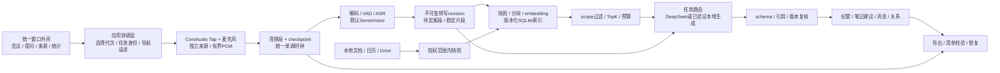
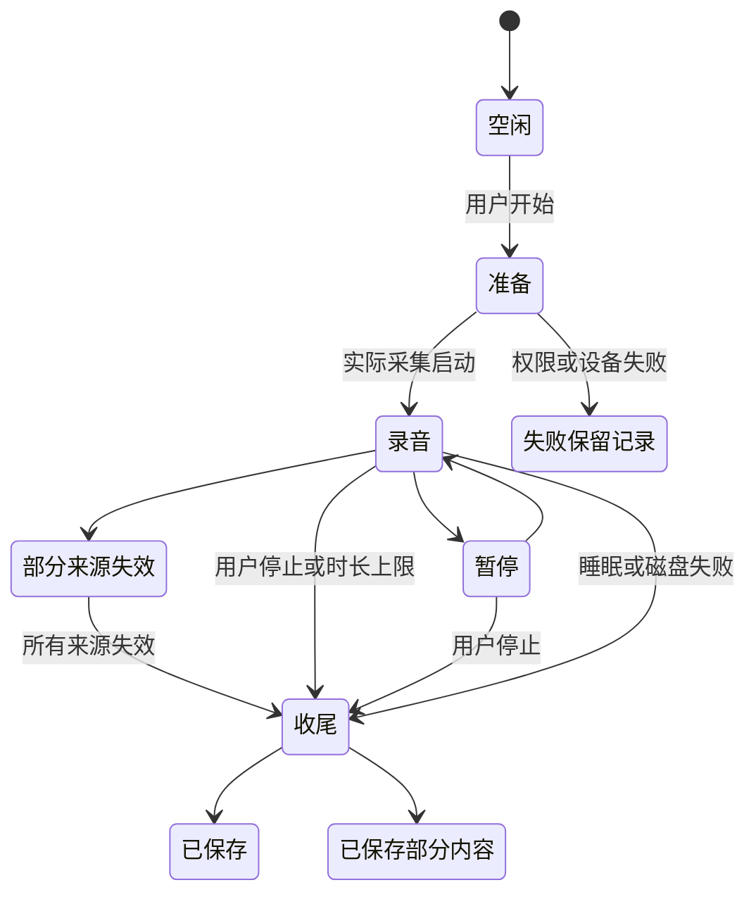

# 架构、状态和数据契约 v0.7

以下是自主开发的目标架构，不是恢复的Foresight源码。实现必须服从截图布局，但UI组件不能拥有或重建长生命周期采集/模型任务。

## 1. 分层与数据流

模块：WindowShell、MeetingTimeline、CaptureService、ASRJobService、RevisionRepository、SourceIndexService、RetrievalService、GenerationRouter、ConversationRepository、CalendarConnector、DriveConnector、VoiceInputService、DiarizationService、KnowledgeOrganizer、ExportBackupService、Diagnostics。已有类名可复用，但每个边界要有清晰任务/取消/版本所有权。

整个应用共享同一个SourceIndex service及其数据库连接；UI/会议桥接不能各自初始化并触发互相覆盖的恢复状态。采集服务、模型资源管理、录音协调层不随View的出现/消失重新创建。

## 2. 核心对象

| 对象 | 必需身份与字段 | 不变量 |
|---|---|---|
| Meeting | UUID、title、createdAt、timeZone、mode、state、duration、activeTranscriptID、activeMinutesID | 会议ID不复用，标题不是身份 |
| AudioTrack/Segment | UUID或不可变文件ID、source、relativePath、sampleRate、frames、channels、startOffset、duration、contentSHA256 | source不是speaker；媒体路径属于会议目录；偏移来自共同单调时钟 |
| CaptureCheckpoint | meetingID、sequence、completedTracks、lastCommittedAt、warnings | 完成音频头和文件关闭后才提交；恢复不读取未完成段当完整 |
| TranscriptRevision | UUID、meetingID、parent、origin、ASR模型/运行时/VAD/provenance、createdAt、segments | 活动/候选指针独立；人工修订不改音频身份/锚点 |
| TranscriptSegment | UUID、audioFile、source、start/end、text、stable、speakerCluster? | 时间有限且start≤end；待定尾段不能正式索引 |
| Source | UUID、URI、type、accountScope、activeRevision、status、epoch、deleted/revoked、importedAt | 删除墓碑阻止迟到复活；首次导入时间不冒充文件mtime |
| SourceRevision | UUID、sourceID、contentHash、parserRevision、snapshotText、embeddingSpace、originRevision | 快照/向量同次激活，不让新文字配旧向量 |
| Chunk/Evidence | UUID、revisionID、textHash、UTF-16/page或会议片段锚点、vector | 引用绑定不可变revision；维度/前缀/归一化属于space |
| ManualNoteRevision | UUID、meetingID、parent、text、explicitEvidenceIDs、updatedAt | 用户原文、AI建议、采用版本分开 |
| MinutesRevision | UUID、meetingID、inputTranscriptID、noteRevisionIDs、template/prompt版本、model、drafts/result | 输出事实可回查；输入更新标过时，不覆盖原文 |
| ActionItem | UUID、minutesID、task、assigner/assignees、dueText/dueDate/timeZone、confirmed、complete、evidence | 未明确负责人不自动署名；相对日期保留原始表达 |
| Conversation/Message | UUID、mode、scope、requestVersion、role、text、complete、model/route、citations、contextMemo | 会话切换不重定向旧请求；失效证据禁跳转 |
| ModelProfile/Route | ID、role、execution、protocol、endpoint、model/checkpoint、credentialRef、capabilities、validation | ID失效报错，不选第一个模型；无隐式云回退 |
| Job | UUID、kind、ownerID、selectionGeneration、inputSnapshot、deadline、state、checkpoint | 取消/选择/删除/结束分别处理，结果需重新核验 |
| CalendarEvent | provider/account/event/instanceID、timezone、start/end、allDay、recurrence、updatedAt | 同名事件不合并；全天日期不按UTC零点错误换天 |
| SyncConnection | provider/account/scope、credentialRef、selection、cursor、revoked、lastSuccess、retry | 凭据独立于模型Key；撤权先停检索再清缓存 |
| SpeakerCluster | recordingID、clusterID、intervals、overlap/uncertain、userConfirmedName | 匿名cluster不是联系人；两轨也不是两位实名说话人 |
| Label/Wiki/Relation | UUID、sourceRevisionRefs、origin(user/derived)、evidence、stale | 关系建议不提升为已证实事实；来源变化触发失效 |
| ExportManifest | schema、files/path/size/hash、source/revision/model/prompt/route、createdAt、timezone | 不含Key；导出成功文件可复核；恢复后锚点不漂移 |

字符串、时间、集合和文件大小都需有边界；不可信JSON不能通过Int(Double.nan/巨数)让UI崩溃。源标题和文件名不是权限边界。旧格式迁移必须可回滚并保存损坏原件，不能清空整库“修复”。

## 3. 持久化和事务

- 音频独立不可变文件，录音manifest/当前指针使用原子提交；SQLite保存资料/快照/chunks/vectors及关联。账号撤权/删除epoch能让在途推理结果失效。
- 会议转写首次成为活动版或显式采用新版本时，旧索引先退出可检索集合，随后发布同revision的新快照和向量。失败显示待更新/失败，不能继续从旧活动转写答题。
- 会议与索引跨存储不能假称单事务：使用可恢复意图/版本ticket，记录prepare→repository pointer→index publish阶段；恢复只处理不一致项，不在每次浏览时清空全部正常会议索引。
- 同revision同内容同embedding space重复协调幂等，无需重复推理。删除先登记永久墓碑并取消在途任务，再移除音频/转写/派生产物；失败时保留删除中与重试，不反向复活。
- 文档重新导入与会议显式采用不同：文档更新失败可以继续标明旧版本；会议当前转写已变更时不得把旧转写当当前答题。两种策略在UI状态中明确。
- 保存手工笔记/行动项按对象串行提交，写盘成功才发布已保存状态。失败保留用户草稿；导出等待这些写入完成并冻结快照。

## 4. 音频导入的提交契约

先打开源文件descriptor并确认regular/大小，逐块复制至应用私有暂存目录；源descriptor前后size/mtime/ctime/身份变化则失败。实际完成的副本必须重新核验hash、可解码性、采样率、帧数和时长；不能沿用复制前源文件的元数据。

输入/PCM均有界（复制块≤1MiB、解码块有固定帧上限），长导入可取消。最终创建/提交需在repository actor内部设置明确提交线性化点：排队期间取消必须在落盘前检查；取消在提交完成后到达则按已完成记录呈现，不假称未发生。失败清理仅限本任务拥有的暂存/新建目录，清理失败有诊断。

必须验证有效副本换成另一份有效音频、同长度内容变化、截断/坏头、源文件移动/删除、取消在复制/解码/提交排队期间、磁盘写失败。hash与元数据必须来自同一最终副本，不能“新时长+旧hash”。

## 5. 采集和任务生命周期

CoreAudio listener块和IO块不继承MainActor执行器；回调指针不跨异步边界。所有listener保留精确object/address/queue/block，停止先失效generation/关闭接收再移除及排空回调，然后销毁设备/tap。格式通知关闭解析入口，旧快照只能在epoch未变化时重开，防止按旧格式读新缓冲。

静音、电平0、没有新回调不自动意味着权限被撤销；只根据可观察的实际HAL错误/对象状态报告。公开接口无法区分的情况列为能力边界，不通过周期重建tap或屏幕采集探测权限。

录音对象与ASR/生成/页面独立；来源失败只停对应来源。应用退出等待采集停止、writer drain、manifest提交，模型与网络取消也要等待资源回收。

## 6. 模型能力与执行位置

默认资产：SenseVoice INT8+sherpa-onnx、固定Silero VAD、旧版EmbeddingGemma 300M文本向量模型与本机runtime；具体文件/hash/license见默认资产清单。应用首次打开校验内置资产，故障修复不改活动任务版本。P0无全局Python依赖，也不静默升级embedding。

截图显示EmbeddingGemma 2，当前官方文档说明它支持多模态输入并输出向量；这不是ASR文字输出接口。旧300M文本模型和2代不能仅因都输出768维就混搜，新space必须含模型checkpoint/格式/维度/前缀/归一化/encoder profile。2代在P2做候选评测，不在此次文档工作中下载或默认替换。[旧版模型卡](https://ai.google.dev/gemma/docs/embeddinggemma/model_card)，[2代模型卡](https://ai.google.dev/gemma/docs/embeddinggemma/model_card_2?hl=en)。

DeepSeek基线：`https://api.deepseek.com`，Chat Completions，`deepseek-flash`；2026-10-17官方文档核对仍列此ID，实际账号可用性未测试。支持手工修改模型，列表发现不等于功能通过。[模型接口](https://api-docs.deepseek.com/api/list-models/)，[生成接口](https://api-docs.deepseek.com/api/create-chat-completion/)。用户当前暂不配置Key，云UAT保持待验。

P1的Qwen/FunASR是ASR候选角色，与Qwen本地对话生成独立，不能因名字同属一个系列就复用能力。每个profile分别测试fileASR/分段实时/时间/热词/说话人/文本生成/JSON/stream/tools；未支持就明确展示。通过云生成测试不能启用云ASR。

## 7. 数据外发与范围

Key存本应用Keychain引用，配置、诊断、导出无Key；替换写失败保留旧凭据，不能先删后加而丢Key。模型请求按任务冻结endpoint/model/route与scope，不接受原文中的URL/工具指令改变目的地。

默认ASR/embedding本机，云生成默认关闭；用户启用后只发当前任务必要文本和召回片段，不上传原始音频或整库。local_only失败保持失败，不跳云。localhost仅标用户声明本机，应用自管服务需断网实测才证明离线。

会议/文档删除或账号撤权后，先过滤召回再取消在途问答，发布前复验。历史用户文字可以保留，但失效引用正文缓存移除、跳转禁用；删除确认提供连同派生聊天清除的选项。导出文件不受应用后续远程撤回。

## 8. 备份、诊断和长期可读

P0可读导出：原轨、TXT/Markdown、结构化JSON和带清单ZIP。所有路径受控，写入私有暂存、检查字节/hash，最终同卷原子激活；取消/失败保留已有目标。zip压缩进程必须可取消、TERM后有界终止并回收，不能孤儿运行。

P1完整备份：冻结当前及历史revision、输入关系、标签/会话/引用、模型与prompt版本，不含凭据；恢复前校验schema/path/hash/大小，支持导入到新库、ID冲突与损坏报告，不覆盖现库来“试一下”。只有恢复实测通过才叫完整备份。

诊断默认只记录任务/阶段/版本/耗时/错误类别/资源预算、来源状态和hash，不记录正文/Key。脱敏导出需可预览。长期可读优先开放文件格式、时间/时区、revision和证据清单，不让数据只能依赖单一模型或服务读取。
