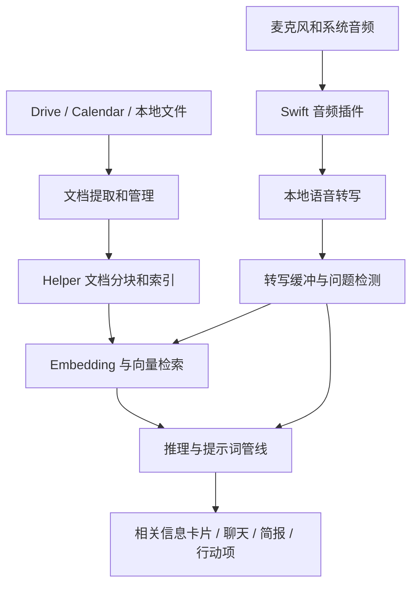

# Foresight 静态逆向记录

分析目标为 `/Applications/Foresight.app`，日期 2026-10-14。本文只描述已安装程序包中的证据，不读取用户的录音、文档、令牌或业务数据库，也未运行 Foresight。

## 当前结论

Foresight 的核心设计是本地会议助手：采集麦克风和系统音频，形成转写文本，检测值得回答的问题，检索个人资料，再生成相关信息、会议摘要、行动项与会前简报。这个端到端顺序是结合模块和提示词作出的架构推断，尚未逐函数验证。

程序包含 Flutter/Dart 界面、Swift macOS 插件、C++ 推理和检索组件，以及独立的 ForesightHelper 后台服务。包内不仅有本地模型路径，还存在 Gemini 服务模块、Google 账号与远端 API 接口。因此不能仅根据“本地 AI”文案断言所有功能始终离线或没有网络请求。

## 证据与可信度

| 结论 | 证据 | 状态 |
|---|---|---|
| Bundle ID 为 com.google.AIEdgeForesight；版本 1.0.0；构建 1.0.0.28.20261005 | Info.plist，已复制到 evidence/metadata.json | 已观察 |
| 主程序为 ARM64 Mach-O；链接 FlutterMacOS、Swift、CoreAudio、Metal、SQLite 等 | REA Mach-O 元数据；nm 符号 | 已观察 |
| 预设 Gemma 4 12B、E4B、E2B 三档本地模型 | on_device_model_configure.json | 已观察的配置，未验证实际下载和运行 |
| 麦克风与系统音频采集实现存在 | AudioCapturePlugin、InputRecorder、ProcessTap 符号及 AudioHardwareCreateProcessTap 日志 | 静态实现线索，未验证实时调用 |
| 文档索引与多模态 embedding 的后台接口存在 | 主程序与 Helper 的相同 RagService RPC 名称 | 已观察的接口声明，未验证实际请求 |
| Helper 有文档与设置存储设计 | 完整建表与读写 SQL，agent_metadata.db、rag_vector.db 字符串 | 已观察的 SQL，未检查用户数据库 |
| 会议简报、行动项、笔记增强、聊天记忆压缩等提示词存在 | 主程序字节偏移与 prompt-candidates.json | 已观察的内置文本，未验证启用条件 |
| 有本地推理与云端服务两类相关模块 | llm_inference_engine.dart、gemini_service_model.dart、odml_service.dart 等身份字符串 | 组件存在；路由条件未知 |

REA 原生检查 Evidence ID 为 `ev_d5e0701b851c86ba9992f9c89cec16c63824cdb4ce85013828b2cc40f78be378`。完整记录保存在 `evidence/rea-bundle.json`，较小的摘要在 `evidence/macho-summary.json`。字符串、符号和资源提取来自系统工具，不能把这些输出冒称为 REA 的函数反编译证据。

主程序 SHA-256 为 `fa98b856bfbe9b40cdebfb9f975f7867ec5c0a3ca75b81214a096a60b6db8326`。从程序自带 tar 中提取的 Helper SHA-256 为 `c96e3fbbd5769932dc5dac04b95a185af06f9e40eb2b51a7168841b7c69c1a0e`。

## 可还原的架构



图中箭头表示推断的数据流，不能当作已捕获的运行时调用图。

已识别 408 个属于 Foresight 的 Dart 包文件身份字符串，名单见 `evidence/dart-modules.txt`。这里只恢复文件身份，没有恢复原始 Dart 文件内容。

关键模块包括：

- query_detector_on_device、query_dispatcher、transcript_buffer、transcript_manager、speaker_id_manager、text_deduplicator。
- document_fetcher、document_downloader、document_embedder、document_manager、local_file_processor、pdf_fetcher、google_docs_fetcher。
- inference_pipeline、system_prompted_pipeline、llm_inference_engine、map_reduce_executor、queued_executor。
- transcript_summary_manager、action_items_manager、notes_enhancer、attachment_summary_manager、meeting_search_engine。
- background_agent_proxy、calendar_service、auth_service、gemini_service_model、odml_service。

转写缓冲包含一条初始化日志，标记 `maxWordCount=200`、`maxUiLines=4`、`fillGapMs=2000`。它是打包日志中的值，不能保证所有运行配置都采用这些参数。

## 本地模型配置

| 模型名称 | 配置中的最低设备内存 GB | 音频后端 | 视觉后端 | 视觉 token 预算 |
|---|---:|---|---|---:|
| Gemma 4 12B | 30 | GPU | GPU | 560 |
| Gemma 4 E4B | 15 | CPU | GPU | 280 |
| Gemma 4 E2B | 6 | CPU | GPU | 280 |

三档都配置了视觉与音频支持、推测解码、关闭 thinking；默认上下文长度 4096，temperature 0.4、topK 40、topP 0.9、repetitionPenalty 1.05。这些是 Foresight 的配置值，不代表模型完整规格或实际内存用量。

包内包含 LiteRT、Metal/WebGPU accelerator 和 TopK sampler 动态库。二进制中存在 EmbeddingGemma、LiteRtLmEmbeddingModel 和对应初始化、文本/图像/音频 embedding 函数身份。

## Helper 与存储

Helper 内含“Launch Agent listening on Unix Socket”日志，说明设计中存在 Unix socket 通信。套接字实际路径、权限和鉴权方式尚未验证。

RagService 接口共识别 11 项：IndexDocument、RetrieveContext、UpdateModelPaths、DeleteDocument、Encode、ChunkText、TruncateText、ComputeEmbedding、ComputeImageEmbedding、ComputeAudioEmbedding、Ping。完整名称见 `evidence/rpc-methods.json`。

Helper 的数据库语句声明以下表：

```sql
CREATE TABLE IF NOT EXISTS documents (
  id TEXT PRIMARY KEY,
  content TEXT,
  userId TEXT,
  maxTokensPerChunk INTEGER,
  chunkOverlap INTEGER,
  mimeType TEXT,
  imageBytes BLOB
);
CREATE TABLE IF NOT EXISTS settings (key TEXT PRIMARY KEY, value TEXT);
```

主程序还有一条针对 node_embeddings 的检索语句，以 vector_cos_similarity 计算相似度，降序取第一项。符号 `_findBestMatch` 位于 `0x10002a78c`。语句和符号均已观察，但二者的函数级关联尚未由反编译或交叉引用确认。

## 内置提示词

提示词候选已保存至 `evidence/prompt-candidates.json`，每项保留主程序中的文件偏移。提取边界是连续可打印字节，可能含邻近常量，不能视为已恢复的源代码对象。

几个具有产品意义的设计：

- 简报模板固定为 Overview、Action Items、Details，要求内容只来自转写并保留真实姓名。
- 行动项要求任务具体、源自讨论、有承接人且会后执行；用“we/us”时避免猜测个人。
- 分段摘要忽略寒暄，聚焦决策、结果、待办和分歧；不把 Microphone/Remote 当作真实人名。
- 笔记增强按每条手写笔记指定的转写引用补充内容，并优先保留用户写下的专名与缩写。
- 一套问答提示词要求优先使用检索上下文，使用 Source 引用；上下文不足时生成 google_search 工具调用。
- 聊天历史压缩为 Context Memo，保留事实、决策、用户偏好和中间结论。

这些提示词并不保证所有会话采用同一模板，也不保证模型实际遵守。

## 网络与隐私边界

程序内有 Drive、Calendar、Docs、Slides 的只读 OAuth scope、odml.pa.googleapis.com 接口、Calendar webhook、Google 登录、Firebase 消息与分析相关组件。它们证明相关集成被打包，不能证明每个端点实际收到数据。

程序自带说明文本称登录可选，登录后可访问 Drive 和 Calendar，并提及汇总使用数据收集。这是产品声明，不等同于经过独立验证的网络行为。实际是否上传音频、转写、提示词或文档，需要单独观察具体运行场景。

## 未解决问题与工具状态

1. 端到端问题检测、检索、生成的真实调用顺序与分支条件。
2. 触发阈值、冷却时间、上下文拼接、V1/V2 检索策略和排序细节。
3. 本地/云端模型选择条件，以及具体网络载荷。
4. Helper 的真实启动参数、socket 权限、模型路径和错误恢复。
5. Dart AOT 业务函数的可读重建范围。

Hopper 没有许可证，首次桥接启动停在许可窗口。进入演示模式后 REA 的旧会话仍报告 cleanup_incomplete，未获得任何函数伪代码。用户已要求替换该引擎。替代方案为免费 Ghidra 12.1.4，REA 6.4.0 的本地安装策略明确支持该版本；需要 Java 21。

工具下载和配置进度另见 `引擎切换状态.md`。当前报告属于有证据的静态梳理，函数反编译与运行时验证仍未完成。
